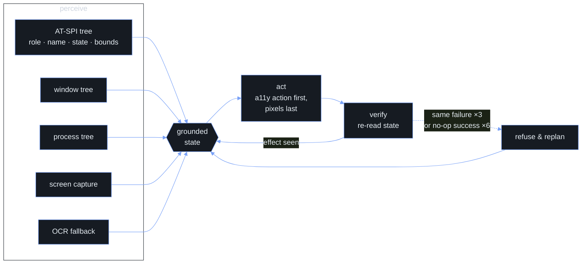
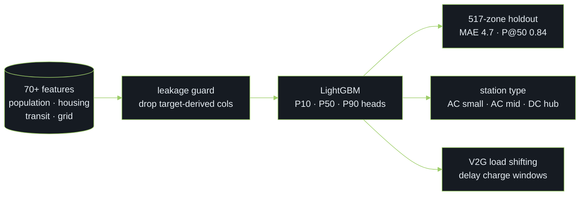
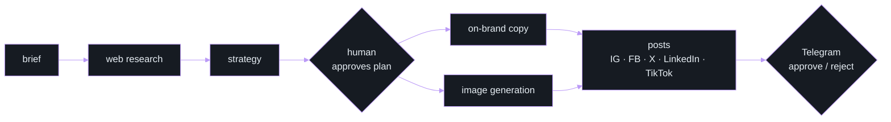

<div align="center">

# Felix Cumarav

**I build agents that operate real software, models measured against a baseline,<br>and the production systems around them, from database to App Store.**

Prague &nbsp;·&nbsp; ČAIO 2026 finalist &nbsp;·&nbsp; open to contract work

<kbd>&nbsp;[LAI](https://github.com/cufelix/lai)&nbsp;</kbd> &nbsp;
<kbd>&nbsp;[Kestrel](https://github.com/cufelix/kestrel)&nbsp;</kbd> &nbsp;
<kbd>&nbsp;[VoltPlán](https://github.com/cufelix/notokens_olymp)&nbsp;</kbd> &nbsp;
<kbd>&nbsp;[Virlya](https://virlya.com)&nbsp;</kbd> &nbsp;
<kbd>&nbsp;[felix.cumarav@gmail.com](mailto:felix.cumarav@gmail.com)&nbsp;</kbd>

</div>

<br>

```diff
$ lai do "open the text editor, write a haiku about X11, save it to ~/haiku.txt"

  ▸ app_open      {"name": "Text Editor"}
+   ✓ window up after 0.6s
  ▸ ui_snapshot
+   ✓ 57 accessible elements
  ▸ ui_type       {"ref": 12, "text": "Pixels in a grid…"}
+   ✓ set via a11y_set_text
  ▸ ui_click      {"name": "Save"}
+   ✓ invoked via a11y_action, not a pixel click
  ▸ file_read     {"path": "~/haiku.txt"}
+   ✓ effect verified on disk

@@ completed: 8 steps in 34s @@
```

<br>

## Results

| Project | What was measured | Mine | Baseline |
|:--|:--|--:|--:|
| **Kestrel** | tool calls for the same task, same model, same tools | **7** | 18 &nbsp;<sub>opencode + MCP</sub> |
| **Kestrel** | accessible elements visible in VS Code after one fix | **69** | 1 |
| **VoltPlán** | MAE, EV charging demand per zone per day (517-zone holdout) | **4.7** | 84 % worse <sub>∝ population</sub> |
| **VoltPlán** | Precision@50, zones that matter for placement | **0.84** | |
| **LAI** | test suite | **1,825** tests | |
| **OFC Poker** | friend search, 300k users | **0.5 ms** | 45 ms |
| **OFC Poker** | scheduler due-query, 3M job rows | **0.1 ms** | 258 ms |

<br>

## Production

I ship the unglamorous half too: payments, auth, backups, firewalls, store releases.

**OFC Poker** &nbsp;<sub>client contract · in build · 95 PRs</sub><br>
Real-time multiplayer card game for iOS and Android. The rules engine is a Rust crate shared with the Node server through native bindings; the app is Expo / React Native, play runs over WebSockets with matchmaking, private tables, tournaments and bots in three difficulties on worker threads. Hardened like it will be attacked: nftables rate limits, Caddy security headers, instant token revocation through Redis, point-in-time restore drills, Prometheus alerts and a Grafana dashboard. Load-tested at 300 concurrent players.

**[Pripoj.to](https://github.com/cufelix/voz01)** &nbsp;<sub>full product</sub><br>
Trailer rental end to end: React Native app, Next.js admin, Firebase Cloud Functions, Stripe payments and Igloohome smart locks, so the customer picks up a trailer with no one there to hand over a key.

**Meal-box ordering system** &nbsp;<sub>client · in development</sub><br>
For a meal-box delivery company: web shop with weekly menus and allergens, delivery-zone checks drawn on a map, online payments, automatic matching of bank-statement payments to invoices, accounting export and a CRM behind it all.

<sub>Also: Forksy, a nutrition tracker, and PhAuth, phone-number sign-in, both React Native / Expo.</sub>

<br>

## Desktop agents · [LAI](https://github.com/cufelix/lai) + [Kestrel](https://github.com/cufelix/kestrel)

Desktop agents mostly fail on **grounding**: a model looking at a screenshot guesses coordinates and guesses wrong. LAI reads the AT-SPI accessibility tree, the desktop's DOM, fuses it with four other sources of truth and invokes widgets through their own accessible actions. Pixels are the fallback, not the plan.



**Kestrel** puts LAI's hands under `sst/opencode`'s agent loop and adds what a plugin can't: memory of the machine it lives on, its own X server so it never takes your mouse, and loop discipline. Same tools over MCP took opencode 18 calls; Kestrel took 7. The tools were identical. The whole gap was the loop.

<sub>Python · TypeScript · Bun · X11 / AT-SPI · MCP · ~47k lines in LAI</sub>

<br>

## Forecasting · [VoltPlán](https://github.com/cufelix/notokens_olymp)

2030 EV-charging demand for every grid zone in Prague, a station-type recommendation per zone, and a V2G layer that resolves grid overloads by moving charge windows instead of building hardware.



<sub>ČAIO 2026 AI Startup track · 2,378 training zones · trained on CPU (Lunar Lake, no CUDA) with sklearnex · Streamlit demo</sub>

<br>

## Multi-agent · [Virlya](https://virlya.com) &nbsp;<sub>live product</sub>

Ten specialised agents turn one brief into a multi-platform campaign. A human signs off on the plan before anything is generated, and approves or rejects finished posts from Telegram.



<br>

## Also

**Inspector AI** &nbsp;<sub>private</sub><br>
Real-time computer vision: one overhead camera per blackjack table checks every payout and alerts a tablet within a second. Full build spec, latency budget and ten experiments behind it. Happy to walk through it.

**Tools for working with agents**<br>
[claude-session-dots](https://github.com/cufelix/claude-session-dots): a panel dot per Claude Code session that turns red when one is waiting on you.<br>
[learn-claude-code](https://github.com/cufelix/learn-claude-code): an AI tutor where answer keys are committed before the question is shown, so the model can't grade itself generously.<br>
[claude-widget](https://github.com/cufelix/claude-widget): 5-hour and weekly usage limits in the Cinnamon panel.

<br>

## How I work

```
1  beat a dumb baseline before believing a smart model
2  fix grounding before tuning prompts; most agent failures are perception failures
3  verify the effect, not the call; a click "succeeds" the moment the event is sent
4  build on a strong base and spend the effort where the gap actually is
```

<br>

<div align="center">

<sub>
<b>ML</b> &nbsp;Python · LightGBM · scikit-learn · polars · DuckDB · Streamlit<br>
<b>Agents</b> &nbsp;tool use · MCP · RAG · vector databases · multi-agent pipelines · evals<br>
<b>Systems</b> &nbsp;TypeScript · Rust · Node · Bun · PostgreSQL · Redis · Docker · Caddy · Linux (X11, AT-SPI)<br>
<b>Product</b> &nbsp;React Native / Expo · Next.js · Firebase · Stripe · Spring Boot
</sub>

</div>
