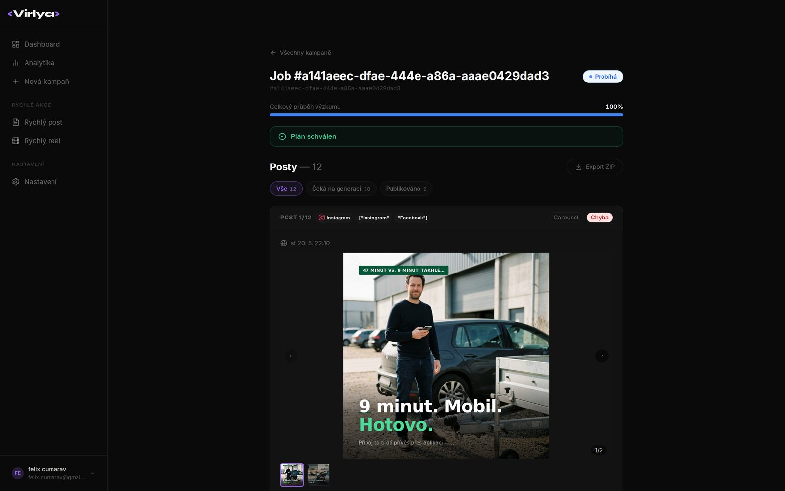
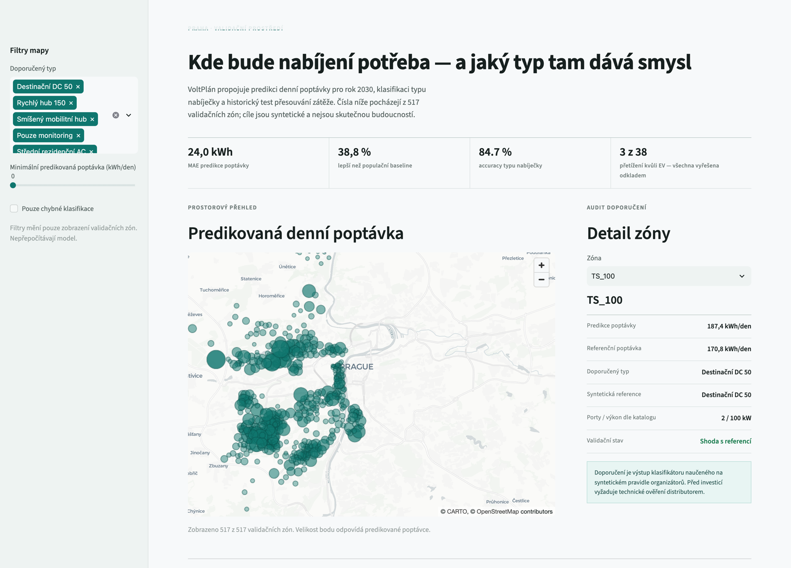

# Felix Cumarav

I build agents that operate real software, and the models and evals that tell me whether they actually work.

Prague · ČAIO 2026 national finalist · open to contract work → [felix.cumarav@gmail.com](mailto:felix.cumarav@gmail.com)

```console
$ lai do "open the text editor, write a haiku about X11, save it to ~/haiku.txt"
▸ app_open     {"name": "Text Editor"}          ✓ window up after 0.6s
▸ ui_snapshot                                   ✓ 57 accessible elements
▸ ui_type      {"ref": 12, "text": "Pixels…"}   ✓ via a11y_set_text
▸ computer_key {"key": "ctrl+s"}                ✓
▸ ui_click     {"name": "Save"}                 ✓ via a11y_action
▸ file_read    {"path": "~/haiku.txt"}          ✓ effect verified on disk
✓ completed — 8 steps in 34s
```

<br>

## Agents

**[LAI](https://github.com/cufelix/lai)** — a native OS agent for Linux. Desktop agents mostly fail on grounding: a model looking at a screenshot guesses coordinates and guesses wrong. LAI reads the AT-SPI accessibility tree (the desktop's DOM) and fuses it with the window tree, the process tree, screen capture and OCR, then invokes widgets through their own accessible actions. Pixels are the fallback, not the plan. Every step is observe → act → verify: success is reported after the state is re-read, not after the click is sent.
<sub>Python · X11 / AT-SPI · MCP server · ~47k lines · 1,825 tests</sub>

**[Kestrel](https://github.com/cufelix/kestrel)** — LAI's hands on top of `sst/opencode`'s agent loop, plus persistent memory of the machine it lives on, and its own X server so it never touches your mouse.
Same task, same model, same tools: opencode driving them over MCP took **18 tool calls**, Kestrel took **7**. The whole gap was loop behaviour — re-reading the tree after it changes, refusing an action that failed the same way three times, refusing one that "succeeded" six times and changed nothing. One fix in the shared hands took VS Code from **1** visible accessible element to **69**.
<sub>TypeScript · Bun · Python</sub>

**[Společník](https://github.com/cufelix/ai_olymp_-finale)** — a legal agent that walks a founder through incorporating an s.r.o. and then keeps tracking their obligations. It derives duties (including deferred ones) by cross-referencing public registers instead of interrogating the user. On the graded scenario set: **0 missed / 0 unnecessary** obligations vs. **28 / 2** for the baseline.
<sub>ČAIO 2026 national final, public-administration track · Python, zero-dependency agent core</sub>

**[Virlya](https://virlya.com)** — ten specialised agents turn one brief into a multi-platform campaign: research, strategy, copy, image generation, publish-ready posts. A human approves the plan before generation and can approve or reject posts from Telegram. Live product.



## Models

**[VoltPlán](https://github.com/cufelix/notokens_olymp)** — 2030 EV-charging demand for every grid zone in Prague, a station-type recommendation per zone, and a V2G load-shifting layer that resolves grid overloads by moving charge windows instead of building hardware.

| VoltPlán | Result |
|---|---|
| Model | LightGBM regression with P10 / P50 / P90 quantile heads, 70+ features |
| Train / holdout | 2,378 zones / 517 zones (own holdout, no leaderboard) |
| MAE | **4.7 EVs/day**, 84 % below the population-proportional baseline |
| Precision@50 | **0.84** on the zones that matter for placement |
| Hygiene | leakage guard drops every target-derived column before training |

<sub>ČAIO 2026 AI Startup track · trained on CPU (Lunar Lake, no CUDA) with sklearnex · Streamlit demo</sub>



**Inspector AI** — real-time computer vision for casino floors: one overhead camera per blackjack table checks every payout and alerts a tablet within a second. Full build spec, latency budget and ten experiments behind it. Private, happy to walk through it.

## Tools for working with agents

- **[claude-session-dots](https://github.com/cufelix/claude-session-dots)** — one panel dot per running Claude Code session; it turns red when one is waiting on you. Parses session transcripts locally, stdlib only.
- **[learn-claude-code](https://github.com/cufelix/learn-claude-code)** — an AI tutor built from Claude Code skills, hooks and subagents. Answer keys are committed before the question is shown, so the model can't grade itself generously. Leitner-box spaced repetition across sessions.
- **[claude-widget](https://github.com/cufelix/claude-widget)** — 5-hour and weekly usage limits in the Cinnamon panel.

## How I work

- Beat a dumb baseline before believing a smart model.
- Fix grounding before tuning prompts. Most agent failures are perception failures.
- Verify the effect, not the call. A click "succeeds" the moment the event is sent.
- Build on a strong base (opencode, NanoClaw) and spend the effort where the gap actually is.

## Stack

**ML** Python · LightGBM · scikit-learn · polars · DuckDB · Streamlit<br>
**Agents** tool use · MCP · RAG · vector databases · multi-agent pipelines · evals<br>
**Systems** TypeScript · Bun · Node · Docker · Linux internals (X11, AT-SPI)<br>
**Product** React Native / Expo · Next.js · Firebase · Stripe · Spring Boot

Also shipped: [Pripoj.to](https://github.com/cufelix/voz01), a trailer-rental platform with a React Native app, Next.js admin, Stripe and Igloohome smart locks for keyless pickup.
